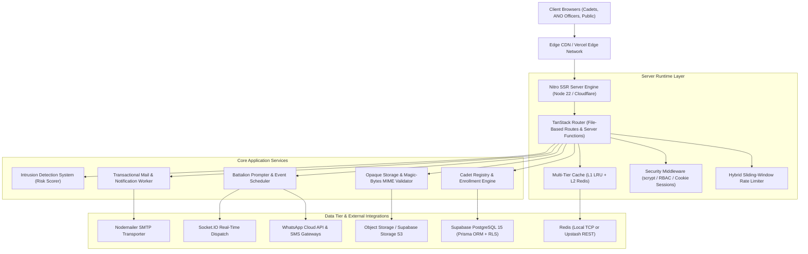

# 19 Jharkhand Battalion NCC Command Centre & Cadet Portal

> Enterprise Cadet Lifecycle Management, Form 1 Enrollment & Institutional Command Platform for **19 Jharkhand Battalion NCC, Sarala Birla University (SBU), Ranchi**.

[](https://github.com/Hellthefox808/NCC-CRM-V1.0/actions/workflows/ci.yml)
[](https://19th-jh-ncc-crm-v1-0.vercel.app/)
[](https://www.typescriptlang.org/)
[](https://nodejs.org/)
[](https://supabase.com)
[](docs/TEST-MATRIX.md)
[](docs/security/SECURITY_BASELINE.md)

---

## Table of Contents

- [Project Introduction](#project-introduction)
- [System Architecture](#system-architecture)
- [Technology Stack](#technology-stack)
- [Repository Structure](#repository-structure)
- [Getting Started](#getting-started)
- [Environment Configuration](#environment-configuration)
- [Testing & Quality Assurance](#testing--quality-assurance)
- [CI/CD & Delivery Pipelines](#cicd--delivery-pipelines)
- [Docker & Container Deployment](#docker--container-deployment)
- [Documentation Index](#documentation-index)
- [Contribution & Governance](#contribution--governance)
- [Privacy & Data Protection](#privacy--data-protection)
- [License & Attribution](#license--attribution)

---

## Project Introduction

The **19 Jharkhand Battalion NCC Command Centre & Cadet Portal** is an institutional software platform designed to manage the end-to-end operational lifecycle of National Cadet Corps (NCC) cadets at Sarala Birla University, Ranchi.

### Operational Scope & User Roles

- **Prospective Applicants**: Access unit information, Physical Efficiency Test (PET) criteria, syllabus details, and complete the 5-step Form 1 Cadet Enrollment wizard.
- **Enrolled Cadets**: Authenticate via single-use token activation and salted `scrypt` credentials, review parade attendance, receive duty rosters, download digital identity credentials, and access training schedules.
- **Associate NCC Officers (ANOs)**: Review and triage candidate applications, request corrections, issue single-use activation credentials, manage nominal rolls, schedule training parades, and publish battalion circulars.
- **Permanent Instructional (PI) Staff & Administrators**: Log muster parade attendance, verify physical documentation, track weapon training and camp quotas, and generate official nominal roll exports.

### Implemented Capabilities

1. **Form 1 Enrollment Engine**: 5-step applicant wizard supporting Senior Division (`SD`) and Senior Wing (`SW`) cadres with client-side draft auto-save, Aadhaar format validation, and Indian mobile (`+91`) normalization.
2. **18-Digit Application Tracking**: Deterministic institutional tracking numbers (`19${YYYYMMDD}${8-digit random}`) with zero-PII-leak public status lookup (`/api/v1/enrollments/status/:query`).
3. **Officer Review & Lifecycle Gate**: Controlled state transitions (`PENDING_ANO_REVIEW` → `APPROVED` / `REJECTED` / `CORRECTION_REQUIRED`) with audit-logged decision remarks.
4. **Single-Use Cryptographic Activation**: 256-bit entropy raw tokens dispatched via time-limited (24-hour TTL) emails; only `sha256(rawToken)` is stored in PostgreSQL.
5. **Session & Credential Security**: Salted `scrypt` password hashing (`N=16384, r=8, p=1`), timing-safe comparisons, and tamper-resistant `HttpOnly; SameSite=Strict; Secure` session cookies (`ncc_session`).
6. **Multi-Channel Notification Dispatch**: Automated dispatch across Email (Nodemailer SMTP), WhatsApp Cloud API, and transactional SMS gateways upon enrollment, approval, and event alerts.
7. **Battalion Calendar & Prompter Engine**: 4-stage automated event alert scheduler (T-24h briefing email, T-2h gear checklist SMS, T-30m Socket.IO real-time notification, T-0m digital roll call).
8. **Nominal Roll Export**: Official RFC 4180 CSV export with UTF-8 BOM (`\uFEFF`) for seamless Microsoft Excel import by battalion headquarters.
9. **Multi-Tier Cache & Rate Limiting**: L1 in-memory LRU cache (`< 0.05ms`) paired with distributed L2 Redis caching (`1.5-3.2ms`) and a sliding-window rate limiter.
10. **Intrusion Detection System (IDS)**: Cumulative security risk scoring with automated defensive throttling, session invalidation, and quarantine escalation.

### Live Deployments

- **Production Portal**: [19th-jh-ncc-crm-v1-0.vercel.app](https://19th-jh-ncc-crm-v1-0.vercel.app/)
- **Upstream Repository**: [Hellthefox808/NCC-CRM-V1.0](https://github.com/Hellthefox808/NCC-CRM-V1.0)

---

## System Architecture

The portal is architected as a high-performance Full-Stack Application leveraging TanStack Start for server-side rendering (SSR) and Nitro for unified server execution across Node.js and serverless edge runtimes.



### Component Status & Boundary Disclaimers

| Component | Status | Operational Context |
| :--- | :--- | :--- |
| **Nitro SSR & TanStack Router** | Required | Primary application server and file-based routing runtime. |
| **Supabase PostgreSQL 15** | Required | Primary persistent datastore (14 relational tables, migrations, Prisma ORM). |
| **L1 In-Memory LRU Cache** | Required | Built-in zero-latency local caching layer. |
| **Redis (TCP / Upstash REST)** | Optional / Fallback | L2 distributed cache. Falls back gracefully to L1 in-memory when unavailable. |
| **SMTP Notification Dispatch** | Optional / Fallback | Production uses SMTP host; development falls back to mock/JSON console logger. |
| **MongoDB Atlas** | Optional | Secondary datastore for unstructured logs and analytical aggregation. |

---

## Technology Stack

### Frontend Application

- **Core Framework**: React 19 (`^19.0.0`)
- **SSR & Routing**: TanStack Start (`^1.168.32`) & TanStack Router (`^1.170.18`)
- **Styling & Design System**: Tailwind CSS v4 (`@tailwindcss/vite ^4.2.1`) with military Regimental Glassmorphism tokens
- **Component Primitives**: Radix UI (Dialog, Dropdown, Tabs, Tooltip, Progress, Accordion)
- **Animation & Visuals**: Framer Motion (`^12.4.7`), Canvas Confetti, Lucide Icons

### Backend & Server Runtime

- **Server Engine**: Nitro 3.0 via Vite 8.2 (`vite ^8.2.0`)
- **Target Runtime**: Node.js 22 LTS
- **Data Access & Schema**: Prisma ORM (`@prisma/client ^7.9.1`, `prisma ^7.9.1`) & Supabase JS (`@supabase/supabase-js ^2.112.3`)
- **Validation**: Zod schema validation
- **Caching**: `ioredis` for TCP Redis, `@upstash/redis` for serverless REST Redis

### Security & Authentication

- **Password Derivation**: Salted `scrypt` (`N=16384, r=8, p=1`)
- **Tokens**: 256-bit cryptographically secure activation tokens (`crypto.randomBytes(32)`), stored as SHA-256 hashes
- **Sessions**: `HttpOnly; SameSite=Strict; Secure` session cookies (`ncc_session`)
- **File Security**: Magic-bytes binary header inspection for MIME verification

### Testing & Tooling

- **Test Runner**: Node.js Built-in Test Runner (`node --import tsx --test`)
- **TypeScript**: TypeScript 5.8 in strict mode (`tsc --noEmit`)
- **Linter & Formatter**: ESLint 9 (`eslint src backend frontend`) & Prettier

---

## Repository Structure

```text
NCC-CRM-V1.0/
├── .agents/                 # AI agent operating directives and local workflows
├── .github/
│   └── workflows/           # GitHub Actions CI/CD workflows (ci, deploy, pr, audit)
├── backend/
│   ├── integrations/        # External adapters (MongoDB, Supabase, Redis, S3)
│   ├── lib/                 # Core server utilities (auth, crypto, rate limiting, IDS)
│   ├── services/            # Domain services (prompter, notifications, storage, export)
│   └── tests/               # Automated test suites (206 test cases across 71 suites)
├── docs/                    # Architecture, database, security, and CI/CD documentation
│   ├── adr/                 # Architecture Decision Records
│   ├── architecture/        # Topology, domain models, and architecture baselines
│   ├── database/            # ERD diagrams and database schema documentation
│   ├── security/            # Threat models, OTP specs, and security audit reports
│   └── testing/             # Testing strategy, matrices, and fixture guidelines
├── frontend/
│   ├── components/          # Reusable UI components (buttons, badges, inputs, dialogs)
│   ├── design-system/       # Regimental Glassmorphism CSS variables and theme tokens
│   ├── features/            # Feature views (HeroSection, Form1, AboutNCC, Tracker)
│   ├── hooks/               # Custom React hooks (useSocket, useAuth, useTheme)
│   └── styles.css           # Global stylesheet and Tailwind v4 imports
├── prisma/
│   └── schema.prisma        # Prisma relational database schema
├── public/                  # Static assets, battalion crests, and institutional emblems
├── scripts/                 # Operational and database initialization scripts
├── src/
│   ├── routes/              # TanStack file-based routes and API handlers
│   ├── router.tsx           # Application router configuration
│   └── server.ts            # Nitro SSR entrypoint and server lifecycle hooks
├── supabase/
│   └── migrations/          # Version-controlled idempotent SQL migrations and RLS
├── docker-compose.yml       # Multi-container orchestration (Nginx, Redis, App replicas)
├── Dockerfile               # Multi-stage production container build
├── package.json             # Project dependencies, metadata, and lifecycle scripts
└── README.md                # Developer onboarding and project documentation
```

---

## Getting Started

### Prerequisites

- **Node.js**: `>= 22.0.0` (LTS recommended)
- **npm**: `>= 10.0.0`
- **Docker & Docker Compose**: Optional, for local containerized execution

### Step 1: Clone & Install Dependencies

```bash
git clone https://github.com/Hellthefox808/NCC-CRM-V1.0.git
cd NCC-CRM-V1.0
npm ci
```

### Step 2: Configure Environment Variables

Copy the provided environment template to `.env`:

```bash
cp .env.example .env
```

Edit `.env` with your development credentials. For minimal local development, configured Supabase test credentials, a 32-character `JWT_SECRET`, and a `SESSION_SECRET` are required.

> [!WARNING]
> **Client-Side Environment Notice**: Variables prefixed with `VITE_` (e.g. `VITE_SUPABASE_URL`, `VITE_SUPABASE_ANON_KEY`) are bundled into client-side JavaScript sent to the browser. **Never** assign service-role keys, database passwords, session secrets, or private tokens to `VITE_` variables.

### Step 3: Generate Prisma Client

```bash
npm run prisma:generate
```

### Step 4: Start Development Server

```bash
npm run dev
```

The portal will be accessible locally at `http://localhost:3000`.

---

## Environment Configuration

The repository uses environment variables documented in [`.env.example`](.env.example). Grouped by subsystem:

| Group | Variable Name | Required | Description |
| :--- | :--- | :---: | :--- |
| **Server** | `NODE_ENV` | Yes | `development`, `test`, or `production`. |
| **Server** | `PORT` | No | HTTP listening port (default: `3000`). |
| **Client** | `VITE_SUPABASE_URL` | Yes | Public Supabase project URL (browser-safe). |
| **Client** | `VITE_SUPABASE_ANON_KEY` | Yes | Supabase public anonymous API key (browser-safe). |
| **Client** | `VITE_WS_HOST` | No | Real-time WebSocket server address (default: `http://localhost:3000`). |
| **Database** | `SUPABASE_SERVICE_ROLE_KEY` | Yes | **Server-only** Supabase administrative service role key. |
| **Database** | `DATABASE_URL` | Yes | PostgreSQL connection string for pooled connections (PgBouncer). |
| **Database** | `DIRECT_URL` | Yes | Direct PostgreSQL connection string for migrations. |
| **Security** | `JWT_SECRET` | Yes | Minimum 32-character cryptographic secret for signing user tokens. |
| **Security** | `SESSION_SECRET` | Yes | Minimum 32-byte secret for cookie session encryption. |
| **Security** | `DRAFT_ENCRYPTION_KEY` | No | 32-byte hex key for client-side Form 1 draft encryption. |
| **Cache** | `REDIS_URL` | Optional | Connection string for TCP Redis (e.g. `redis://localhost:6379`). |
| **Cache** | `UPSTASH_REDIS_REST_URL` | Optional | Upstash REST URL for serverless edge Redis. |
| **Cache** | `UPSTASH_REDIS_REST_TOKEN` | Optional | Upstash REST authorization token. |
| **Mail** | `SMTP_HOST`, `SMTP_PORT` | Optional | SMTP mail server host and port (default: 587). |
| **Mail** | `SMTP_USER`, `SMTP_PASS` | Optional | Credentials for outbound email notifications. |
| **Analytics** | `MONGODB_URI` | Optional | MongoDB Atlas URI for secondary logging and analytics. |

---

## Testing & Quality Assurance

The repository enforces a comprehensive automated testing matrix executed via the native Node.js test runner and TypeScript compiler.

### Available Quality Scripts

| Script | Command | Purpose |
| :--- | :--- | :--- |
| **Test Suite** | `npm test` | Runs 224 automated tests across 75 suites (`backend/tests/*.test.ts`). |
| **Typecheck** | `npm run typecheck` | Strict TypeScript compiler validation (`tsc --noEmit`). |
| **Linter** | `npm run lint` | ESLint 9 static analysis across `src`, `backend`, and `frontend`. |
| **Prisma Validate** | `npm run prisma:validate` | Validates Prisma schema syntax and relationship integrity. |
| **Prisma Generate** | `npm run prisma:generate` | Generates the strongly typed `@prisma/client`. |
| **Security Audit** | `npm audit --audit-level=critical` | Scans dependency tree for critical vulnerability advisories. |
| **Production Build** | `npm run build` | Compiles client assets and Nitro SSR server bundle into `.output/`. |

For complete test case breakdowns, suite categories, and execution logs, consult [`docs/TEST-MATRIX.md`](docs/TEST-MATRIX.md).

---

## CI/CD & Delivery Pipelines

Continuous Integration and Continuous Delivery are automated via GitHub Actions across 4 dedicated workflows:

1. **CI Quality Pipeline** ([`.github/workflows/ci.yml`](.github/workflows/ci.yml)):
   Triggers on pushes and PRs to `main`. Executes 7 parallel and sequenced validation gates: `lint`, `typecheck`, `test`, `prisma-validate`, `security-check`, `build`, and `docker-validate`.
2. **Production Deployment** ([`.github/workflows/deploy.yml`](.github/workflows/deploy.yml)):
   Triggers upon successful CI completion on `main`. Handles immutable container tagging, health probe validation, and automated rollback signaling.
3. **PR Validation Gate** ([`.github/workflows/pr-validation.yml`](.github/workflows/pr-validation.yml)):
   Enforces Conventional Commits title hygiene and flags pull requests exceeding 2,500 lines.
4. **Scheduled Security Audit** ([`.github/workflows/security-audit.yml`](.github/workflows/security-audit.yml)):
   Runs weekly on Sundays at midnight UTC to audit dependency advisories and inspect Git commit history for secret patterns.

Contributors should consult live [GitHub Actions Run History](https://github.com/Hellthefox808/NCC-CRM-V1.0/actions) for current build and verification status.

---

## Docker & Container Deployment

A multi-container setup is defined in [`docker-compose.yml`](docker-compose.yml):

- **`nginx`**: Alpine-based reverse proxy and load balancer exposing port `80`.
- **`redis`**: Redis 7 Alpine cache bound to `127.0.0.1:6379` with persistent volume `redis_data`.
- **`ncc-app-1` & `ncc-app-2`**: Dual Nitro SSR application nodes running on port `3000` with active liveness health checks (`/api/v1/health?type=liveness`).

### Running via Docker Compose

```bash
# Build and launch all services in detached mode
docker-compose up -d --build

# Verify container health status
docker-compose ps

# View service logs
docker-compose logs -f
```

> [!CAUTION]
> **Container Security Notice**: In [`docker-compose.yml`](docker-compose.yml), the Redis service and application nodes specify a fallback parameter `${REDIS_PASSWORD:-...}` for local development convenience. **Production environments must explicitly define a strong, unique `REDIS_PASSWORD` in the deployment environment** or secret manager rather than relying on repository fallback values.

---

## Documentation Index

All technical, architectural, and operational documentation is maintained in the [`docs/`](docs/) directory using verified repository paths:

### Core Architecture & System Context

- [Architecture Blueprint](docs/ARCHITECTURE.md) — Nitro SSR server architecture, runtime topology, and security perimeters.
- [Project Context Baseline](docs/PROJECT-CONTEXT.md) — Comprehensive technical state, subsystem directory map, and dependencies.
- [Authentication & Identity Model](docs/AUTH-MODEL.md) — Scrypt password derivation, 256-bit single-use tokens, and session lifecycles.
- [Database Schema & Data Model](docs/DATABASE.md) — Relational tables, Supabase migrations, Prisma models, and RLS policies.
- [Database ERD Diagram](docs/database/DATABASE_SCHEMA_ERD.md) — Visual Entity-Relationship Diagram for all 14 tables.
- [Caching & Rate Limiting Model](docs/REDIS-MODEL.md) — L1 in-memory + L2 Redis dual-tier caching and sliding-window rate limits.

### Testing, Quality & CI/CD

- [Automated Test Matrix](docs/TEST-MATRIX.md) — Detailed catalog of 206 automated tests across 71 suites with execution evidence.
- [Testing Strategy & Fixtures](docs/testing/testing_strategy_and_fixtures.md) — Guidelines for unit, integration, and mock fixtures.
- [CI/CD Pipeline Specification](docs/CI_CD.md) — GitHub Actions quality gates, deployment stages, and rollback probes.
- [Production Readiness Evaluation](docs/PRODUCTION-READINESS.md) — Evidence-based production readiness scorecard and deployment checklist.

### Security & Governance

- [Security Baseline Specification](docs/security/SECURITY_BASELINE.md) — OWASP ASVS 5.0 L2 security standards and enforcement mechanisms.
- [OTP & Authentication Architecture](docs/security/NCC_CRM_Elite_OTP_Authentication_Architecture.md) — Multi-purpose OTP failover design and rate-limiting.
- [Intrusion Detection System (IDS)](docs/security/IDS_SPECIFICATION.md) — Threat scoring engine and automated defensive rules.
- [API Security Matrix](docs/security/API_SECURITY_MATRIX.md) — Role-based access control (RBAC) per API route.
- [Repository Security Policy](SECURITY.md) — Vulnerability reporting guidelines and supported releases.
- [Architecture Decision Records (ADRs)](docs/adr/INDEX.md) — Index of accepted architectural decision records.

---

## Contribution & Governance

We welcome contributions to the 19 Jharkhand Battalion NCC Command Portal. Please adhere to the following workflow:

### Branching & Commit Workflow

1. Create a focused branch from `main`:

   ```bash
   git checkout -b feature/your-feature-name
   ```

2. Make atomic, focused changes adhering to existing architectural patterns.
3. Validate your changes locally:

   ```bash
   npm run lint
   npm run typecheck
   npm test
   npm run build
   ```

4. Commit using Conventional Commits (`feat:`, `fix:`, `docs:`, `chore:`, `refactor:`).
5. Open a Pull Request targeting `main` with a detailed description of changes, testing evidence, and affected components.

> [!IMPORTANT]
> **Lovable Synchronization Rule**: This project is connected to [Lovable.dev](https://lovable.dev). To preserve project history, **never force-push, rebase, or amend already published Git history**. Commits pushed to connected branches sync back to Lovable. Ensure every commit on `main` is in a clean, fully working state.

---

## Privacy & Data Protection

Because this portal processes sensitive cadet data—including personal identification details, Indian mobile numbers, Aadhaar numbers, residential addresses, academic transcripts, bank account numbers for Direct Benefit Transfer (DBT), and medical fitness declarations—all contributors and system administrators must observe the following data protection principles:

1. **Zero Public PII**: Public lookup endpoints (such as `/api/v1/enrollments/status/:query`) must strictly mask or strip all sensitive fields (Aadhaar, bank account numbers, IFSC, residential address, parentage) before transmission.
2. **Safe Logging & Sanitization**: Never log passwords, raw OTPs, session cookies, unmasked Aadhaar numbers, or bank account details to standard output, server log files, or external APM tools.
3. **Synthetic Test Fixtures**: All automated tests, mock fixtures, and seed data must use synthetic names, fake test Aadhaar numbers (e.g. `123456789012`), and dummy bank credentials. Never commit real cadet records to Git.
4. **Principle of Least Privilege**: Access to full cadet dossiers and nominal roll exports is strictly restricted to authenticated Associate NCC Officers (`requireOfficer` middleware).
5. **Session Isolation**: Session tokens are transmitted via `HttpOnly; SameSite=Strict; Secure` cookies, preventing client-side script access and mitigating cross-site scripting (XSS) extraction risks.

---

## License & Attribution

Maintained for the **19 Jharkhand Battalion NCC, Sarala Birla University Sub-Unit, Ranchi**.
All rights reserved. Developed in accordance with university governance, NCC Directorate standards, and OWASP security recommendations.
